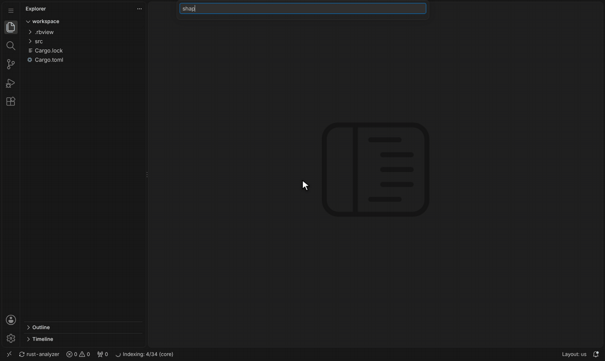
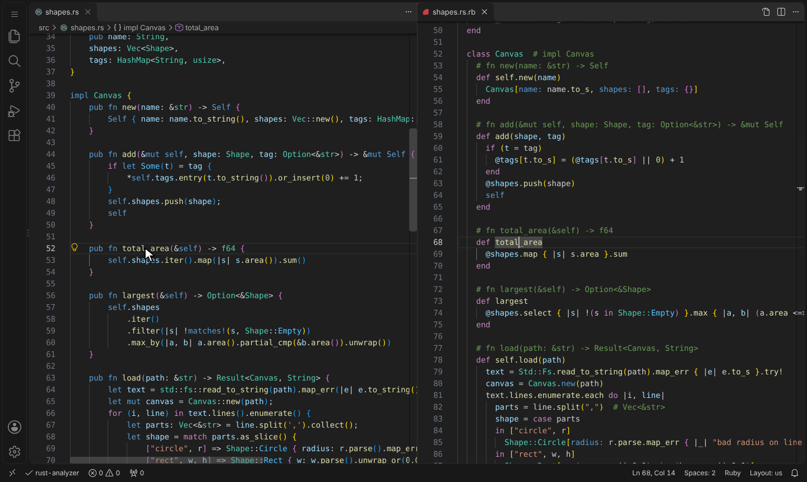
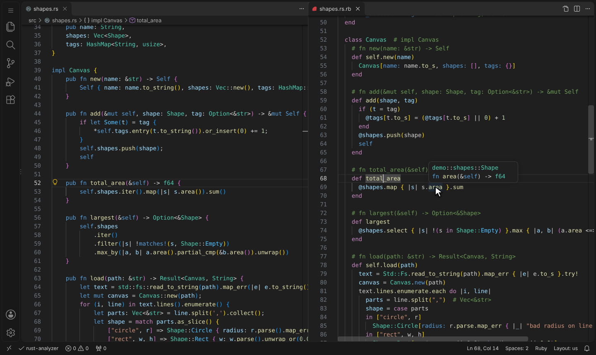
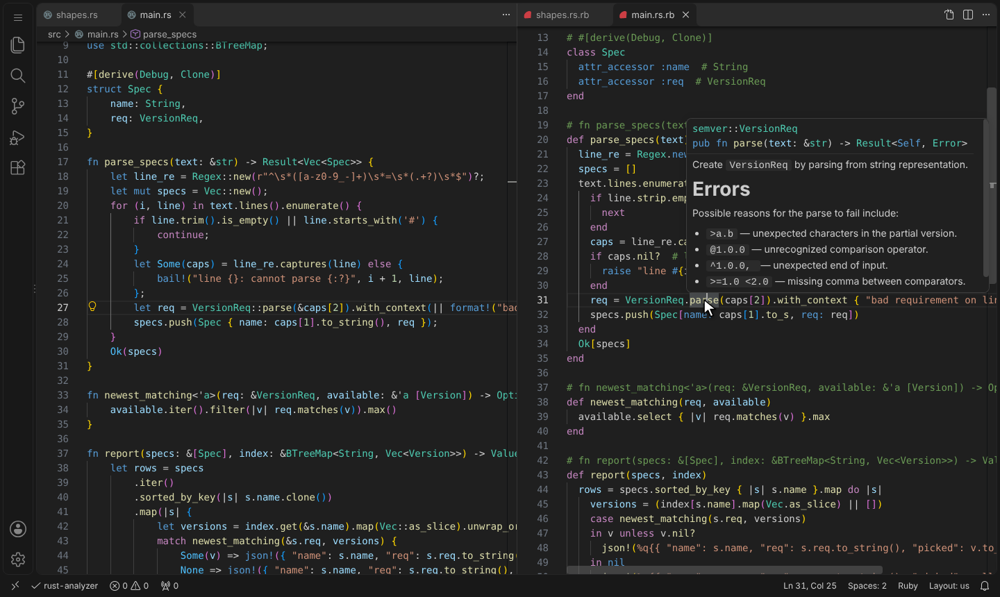
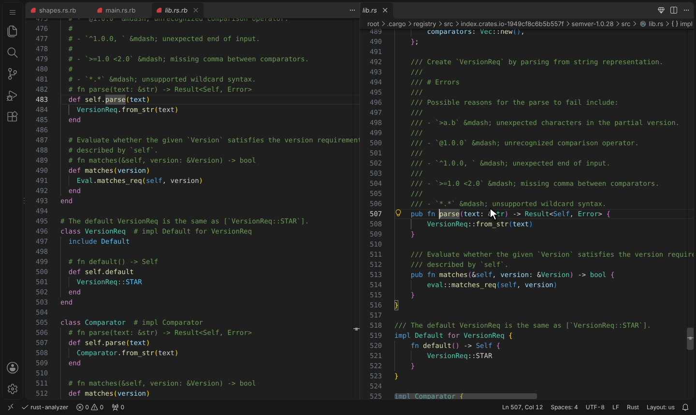

# RubyLens: read Rust as Ruby

**RubyLens** lets you read Rust through a Ruby lens. It turns Rust source into a **read-only Ruby projection**. The editor extension lets you browse it with normal IDE navigation (go to definition, hover, references, outline), all answered by rust-analyzer. The Ruby isn't meant to run. It's there so you can read what a Rust black box is doing in a language you think in.



*Open a Rust file as Ruby, hover, go to definition, jump into a dependency (semver), and back to its Rust source.*

```rust
pub fn total_area(&self) -> f64 {
    self.shapes.iter().map(|s| s.area()).sum()
}

pub fn add(&mut self, shape: Shape, tag: Option<&str>) -> &mut Self {
    if let Some(t) = tag {
        *self.tags.entry(t.to_string()).or_insert(0) += 1;
    }
    self.shapes.push(shape);
    self
}
```

```ruby
# fn total_area(&self) -> f64
def total_area
  @shapes.map { |s| s.area }.sum
end

# fn add(&mut self, shape: Shape, tag: Option<&str>) -> &mut Self
def add(shape, tag)
  if (t = tag)
    @tags[t.to_s] = (@tags[t.to_s] || 0) + 1
  end
  @shapes.push(shape)
  self
end
```

See `examples/demo/src/shapes.rs` and its generated view in `examples/demo/shapes.rb`.

## Install

```sh
cargo install --path .                                  # puts `rubylens` on your PATH
code --install-extension editors/vscode/rubylens-0.1.0.vsix
```

Requires the rust-analyzer VS Code extension.

## Use

- **VS Code:** in any Rust file, click the Ruby icon in the editor title bar or press `Ctrl+Alt+R`. The Ruby view opens beside it at the same spot, and the same key jumps back.
- **CLI:**
  - `rubylens gen src/foo.rs` prints one view.
  - `rubylens build` pre-generates every `.rs` file in the repo.
  - `rubylens serve` answers view requests over stdin/stdout. The extension starts it for you, so views open without starting a process each time.

## Screenshots

| | |
|---|---|
|  |  |
| **Open as Ruby**: the view opens beside the Rust file, at the same spot. | **Hover**: rust-analyzer's answer, in the Ruby view. |
|  |  |
| **Dependencies**: hover and go to definition reach into crates like semver. | **Show Rust Source**: a dependency's Ruby view beside its real Rust. |

These are generated by `tools/capture/capture.sh`, which runs the extension in a real VS Code. See [`tools/capture`](tools/capture/README.md).

## How it works

```
foo.rs ──syn──▶ Ruby text + position map ──▶ rubylens:/…/foo.rs.rb (virtual doc)
                                                   │ go-to-def at Ruby (l,c)
                                                   ▼
                     map back to Rust (l,c) ─▶ rust-analyzer ─▶ target .rs location
                                                   │
                     map forward into the target's Ruby view ◀──┘
```

The generator only does syntax. All semantics (name resolution, trait dispatch, macros, dependencies) come from the live rust-analyzer. That's why it can be fast, lazy and per-file.

### The `.rubylens/` folder

Like `.git` or `.idea`, a hidden folder at the repo root caches everything:

| Path | What |
|---|---|
| `.gitignore` | ignores the whole folder, so nothing is ever committed |
| `_prelude.rb` | stub definitions for Rust-isms (`Ok`, `Err`, `try!`, `unwrap`, `enumerate`, …) |
| `symbols.json` | crate-wide type kinds, so `impl Shape` knows `Shape` is an enum (a Ruby `module`) |
| `index.json` | the types each file defined at the last `rubylens build`, so unchanged files aren't parsed again |
| `src/**.rb`, `*.rb.map.json` | generated views and their position maps, mirroring the repo |
| `ext/<crate>-<version>/**` | views of dependency sources (registry crates are immutable, so they stay cached) |

Every view is keyed by a hash of the source **and of the generator itself**, and records the crate-wide type kinds it relied on. Editing a file, changing a type it uses, or upgrading RubyLens invalidates exactly what changed. Deleting the folder is always safe.

Speed, measured on tokio (555 files):

| | |
|---|---|
| Cold `rubylens build` | 0.38 s |
| Warm `rubylens build` (nothing changed) | 0.02 s |
| One 1,600-line file, uncached: `rubylens gen` / in the editor | 8 ms / 5.4 ms |
| One 1,600-line file, cached: `rubylens gen` / in the editor | 2.3 ms / 0.45 ms |

[docs/performance.md](docs/performance.md) has the details, how to measure, and the rules that keep it fast.

## Translation cheatsheet

The highlights. The full contract, with a golden test for each rule, is [docs/spec/translation.md](docs/spec/translation.md).

| Rust | Ruby view |
|---|---|
| `struct Foo { a: T }` | `class Foo` + `attr_accessor :a  # T` |
| `enum E { A { x }, B(u8), C }` | `module E` with `A = Data.define(:x) { include E }` … |
| `trait T` / `impl T for Foo` | `module T` / `class Foo; include T` |
| `fn new() -> Self` (no `self`) | `def self.new` |
| `Foo { a: 1 }` (struct literal) | `Foo[a: 1]` (distinct from a `Foo.new` call) |
| `match` / `if let` / `matches!` | `case/in`, `if x in Pat`, `(x in Pat)` |
| `Some(x)` / `None` | `x` / `nil` |
| `expr?` | `expr.try!` ("unwrap or return the error") |
| `.iter().filter(..).map(..).collect()` | `.select { }.map { }` |
| `.len()`, `.is_empty()`, `.fold(i, f)` | `.size`, `.empty?`, `.inject(i) { }` |
| `format!("{} is {x:?}", a)` | `"#{a} is #{x.inspect}"` |
| `self.field` | `@field` |
| `&x`, `*x`, `.clone()`, lifetimes, `mut` | dropped |
| Rust signature, generics, field types | kept as comments |
| Items declared inside a function | shown right after the method (Ruby can't nest them) |
| `cfg_rt! { pub fn x() {} }` and other macros wrapping items | the items are translated, between `# cfg_rt! {` and `# }` |
| `macro_rules!` definitions, `tokio::select!` and other DSLs | kept verbatim as comment lines, mapped character-for-character |
| Anything else untranslated inline | kept verbatim as `rust!(%q{…})` |

## Testing

One command runs everything: `scripts/check.sh` (add `--full` for the corpus and real-rust-analyzer checks). [docs/testing.md](docs/testing.md) explains what each check protects.

**Golden tests.** `tests/golden/` holds one small Rust file per translation area, with its expected Ruby. `cargo test` also verifies that:

- every mapped identifier lands on the same Rust identifier;
- at least 95% of Rust identifiers are reachable from the view;
- views pass `ruby -c`;
- every case is cited by the [translation spec](docs/spec/translation.md).

**Against a real rust-analyzer** (`scripts/lsp-check.sh`, plus tokio). Every identifier in the Ruby view is clicked the way the extension would, and the landing spot is checked against what rust-analyzer meant:

| Project | Definitions landing correctly | Into deps / std | References | Outline |
|---|---|---|---|---|
| demo crate | 257 / 257 | 0 / 69 | 27 / 27 | 28 / 28 |
| app using regex, semver, serde_json, itertools, anyhow | 404 / 404 | 36 / 99 | 34 / 34 | 36 / 36 |
| RubyLens's own source (syn, serde, sha2) | 1,509 / 1,509 | 196 / 303 | 559 / 559 | 153 / 153 |
| tokio (4 core files, all features) | 974 / 974 | 24 / 231 | 304 / 304 | 291 / 291 |

Tested with rust-analyzer 2026-08-17 and Rust 1.97 standard-library sources.

**Corpus** (`scripts/corpus-check.py`). Across 2,789 files from 66 pinned real crates (tokio, serde, syn, clap, regex, rayon, …):

- no crashes, and 1 file falls back to raw source;
- 97.8% of views are valid Ruby;
- 2 of 2.1 million mapped identifiers point at the wrong token.

**In VS Code.** `tools/capture/capture.sh` runs the extension in VS Code 1.141 (code-server) against a real rust-analyzer, and every step waits for the expected UI. `node editors/vscode/test/run.js` tests the providers against a mock `vscode`.

## Contributing

Humans and AI agents follow the same guide: **[AGENTS.md](AGENTS.md)**. Start with [docs/intent.md](docs/intent.md), run `scripts/setup.sh` once, and run `scripts/check.sh` before each commit. Specs live in [docs/spec/](docs/spec/) and decision records in [docs/decisions/](docs/decisions/).

## Known limitations

- **Lossy by design.** Ownership, borrowing, lifetimes and `Send`/`Sync` are erased, and they often explain *why* code is shaped the way it is. Use the view as a reading aid; trust the Rust.
- **Bindings inside or-patterns.** Patterns like `A(x) | B(x)` can't be expressed in Ruby, which forbids them. Those few views aren't valid Ruby.
- **Official rust-analyzer extension untested.** The VS Code runs use a minimal stand-in client with the same extension ID (`tools/capture/rust-analyzer-client`), because the official extension couldn't be installed where they ran. Both send the same LSP requests to the same rust-analyzer binary.
- **Macro bodies.** Macros that wrap items are translated. DSL-style macros like `tokio::select!` or `quote!` are shown as verbatim Rust, which still navigates precisely but isn't translated.
- **Feature-gated code.** Code behind cargo features that rust-analyzer considers disabled has no semantics to navigate. Enable the features in your rust-analyzer settings, as you would for Rust.
- **Partly tuned for Ruby readers.** A few method renames assume iterator semantics (`map`/`filter` on `Option` read as Enumerable).

## Ideas for next steps

- **Neovim / other editors.** The same pattern works as a tiny LSP proxy serving `rubylens:` buffers.
- **Workspace symbol search** over `symbols.json`.
- **Optional "explain this method" pass.** An LLM could rewrite one method body more idiomatically, cached by hash, without touching the deterministic skeleton or its navigation.
